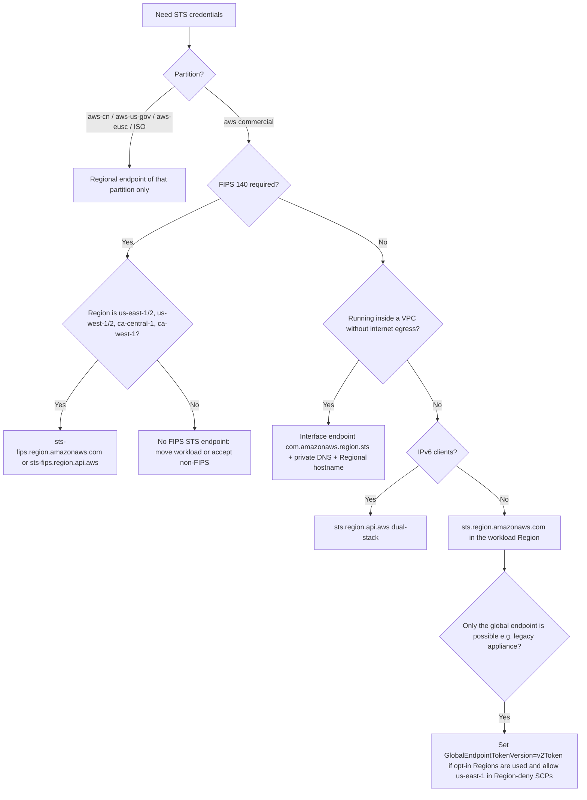

# AWS STS Endpoints Deep Dive

_Last verified: 2026-10-10. Every claim links to its source. Anything not confirmed in official AWS material is marked "(unverified)". Where AWS documents disagree with each other, both are quoted._

## TL;DR

- AWS STS has one legacy **global endpoint**, `https://sts.amazonaws.com`, and a **Regional endpoint** in every Region, `https://sts.<region>.amazonaws.com` ([IAM User Guide: AWS STS Regions and endpoints](https://docs.aws.amazon.com/IAM/latest/UserGuide/id_credentials_temp_region-endpoints.html)).
- Since **April 18, 2025**, global endpoint requests that come from **default-enabled Regions** and are resolved by the **Amazon DNS server** in a VPC are served **in the caller's own Region**. Before that, everything went to US East (N. Virginia). Requests from opt-in Regions, or from anywhere else (on-premises, a public resolver), still go to `us-east-1` ([What's New, 2025-04-18](https://aws.amazon.com/about-aws/whats-new/2025/04/aws-sts-global-endpoint-requests-locally-regions-default/)).
- Even when the request is served locally, global endpoint calls are still **logged to CloudTrail in `us-east-1`** and still evaluate **`aws:RequestedRegion = us-east-1`** ([IAM: global endpoint changes](https://docs.aws.amazon.com/IAM/latest/UserGuide/id_credentials_temp_region-endpoints.html#reference_sts_global_endpoint_changes)).
- Session tokens from Regional endpoints work in **all Regions**. Global endpoint tokens work only in default-enabled Regions, unless the account switches the global endpoint to **v2 tokens**, which are longer ([IAM: Manage AWS STS in an AWS Region](https://docs.aws.amazon.com/IAM/latest/UserGuide/id_credentials_temp_enable-regions.html)).
- On **July 31, 2025**, the remaining SDKs and tools that defaulted to the global endpoint switched to `regional`: Boto3 1.40.0, AWS CLI v1 1.42.0, PHP, C++, .NET and PowerShell ([AWS Developer Tools Blog](https://aws.amazon.com/blogs/developer/updating-aws-sdk-defaults-aws-sts-service-endpoint-and-retry-strategy/), [boto/boto3#4583](https://github.com/boto/boto3/issues/4583), [aws/aws-cli#9634](https://github.com/aws/aws-cli/issues/9634)).
- On **November 21, 2025**, AWS added dual-stack (IPv6) endpoints, `sts.<region>.api.aws`. The global endpoint does **not** support IPv6 ([What's New, 2025-11-21](https://aws.amazon.com/about-aws/whats-new/2025/11/aws-sts-ipv6/), [IAM: Dual-stack endpoint support](https://docs.aws.amazon.com/IAM/latest/UserGuide/reference_dual-stack_endpoint_support.html)).
- AWS recommends Regional endpoints everywhere. Partitions other than commercial **must** use Regional endpoints ([SDK Reference: AWS STS Regional endpoints](https://docs.aws.amazon.com/sdkref/latest/guide/feature-sts-regionalized-endpoints.html)).

## Timeline of endpoint-related changes

| Date | Change | Source |
| --- | --- | --- |
| 2015 (historical) | STS became available in every Region with per-Region activation. Before this, STS was a single global endpoint. | [AWS Security Blog: STS now available in every AWS Region](https://aws.amazon.com/blogs/security/aws-security-token-service-is-now-available-in-every-aws-region/) |
| 2019-03-20 | Regions launched after this date are opt-in (disabled by default). | [AWS Security Blog: permissions for upcoming Regions](https://aws.amazon.com/blogs/security/setting-permissions-to-enable-accounts-for-upcoming-aws-regions/) |
| July 2022 | All new SDK **major** versions released after this point default to `regional`. | [SDK Reference](https://docs.aws.amazon.com/sdkref/latest/guide/feature-sts-regionalized-endpoints.html) |
| 2024-02-26 | AWS publishes "How to use Regional AWS STS endpoints" (updated 2025-04-18 and 2025-07-10). | [AWS Security Blog](https://aws.amazon.com/blogs/security/how-to-use-regional-aws-sts-endpoints/) |
| 2025-01-27 | AWS announces the upcoming global endpoint change. Rollout to start with Europe (Stockholm) and finish by mid-2025. | [AWS Security Blog: upcoming changes](https://aws.amazon.com/blogs/security/announcing-upcoming-changes-to-the-aws-security-token-service-global-endpoint/) |
| 2025-02-10 | AWS announces that SDK STS defaults change to `regional` on 2025-07-31. The retry-strategy default change announced alongside it was later postponed. | [AWS Developer Tools Blog](https://aws.amazon.com/blogs/developer/updating-aws-sdk-defaults-aws-sts-service-endpoint-and-retry-strategy/) |
| 2025-04-18 | Global endpoint now served locally in every default-enabled Region. AWS states this "will not be deployed to opt-in Regions". | [What's New](https://aws.amazon.com/about-aws/whats-new/2025/04/aws-sts-global-endpoint-requests-locally-regions-default/) |
| 2025-07-31 | Boto3 v1.40.0 and AWS CLI v1.42.0 switch the default from `legacy` to `regional`. | [boto/boto3#4583](https://github.com/boto/boto3/issues/4583), [aws/aws-cli#9634](https://github.com/aws/aws-cli/issues/9634) |
| 2025-11-19 | Outbound identity federation launches (`GetWebIdentityToken`), with issuer URLs under `*.tokens.sts.global.api.aws`. | [What's New](https://aws.amazon.com/about-aws/whats-new/2025/11/aws-iam-identity-federation-external-services-jwts/), [IAM: STS OIDC discovery VPC endpoint](https://docs.aws.amazon.com/IAM/latest/UserGuide/reference_sts_oidc_vpc_endpoint_create.html) |
| 2025-11-21 | Dual-stack (IPv6) STS endpoints in all commercial, GovCloud (US) and China Regions. | [What's New](https://aws.amazon.com/about-aws/whats-new/2025/11/aws-sts-ipv6/) |
| 2026-01-15 | AWS European Sovereign Cloud (partition `aws-eusc`, Region `eusc-de-east-1`) becomes generally available. | [AWS Security Blog: ESC initial services (update note)](https://aws.amazon.com/blogs/security/announcing-initial-services-available-in-the-aws-european-sovereign-cloud-backed-by-the-full-power-of-aws/) |
| 2026-09-25 | Interface VPC endpoints for STS OIDC discovery: `com.amazonaws.<region>.sts-oidc`. | [What's New](https://aws.amazon.com/about-aws/whats-new/2026/09/aws-sts-vpc-oidc/) |

## Global endpoint vs Regional endpoints

### Historical behavior

The global endpoint `https://sts.amazonaws.com` "is highly available" but "hosted in a single AWS Region, US East (N. Virginia), and like other endpoints, it doesn't provide automatic failover to endpoints in other Regions" ([IAM: Manage AWS STS in an AWS Region](https://docs.aws.amazon.com/IAM/latest/UserGuide/id_credentials_temp_enable-regions.html)). Any workload that calls it therefore depends on `us-east-1`: "In the unlikely event that the endpoint becomes unavailable in that Region or connectivity between your resources and that Region is lost, your workloads won't be able to use AWS STS to retrieve temporary credentials" ([AWS Security Blog: How to use Regional AWS STS endpoints](https://aws.amazon.com/blogs/security/how-to-use-regional-aws-sts-endpoints/)).

In the SDK endpoint rules, the global endpoint is signed with SigV4 using signing Region `us-east-1`. The `aws-global` pseudo-Region resolves to `https://sts.amazonaws.com` ([botocore STS endpoint-rule-set-1.json](https://github.com/boto/botocore/blob/develop/botocore/data/sts/2011-06-15/endpoint-rule-set-1.json)).

### The 2025 change: the global endpoint is served in the caller's Region

Since **April 18, 2025**, "requests to the AWS STS global endpoint are automatically served in the same Region where the request originates, rather than the US East (N. Virginia) Region. These changes will not be deployed to opt-in Regions" ([IAM: global endpoint changes](https://docs.aws.amazon.com/IAM/latest/UserGuide/id_credentials_temp_region-endpoints.html#reference_sts_global_endpoint_changes), [What's New](https://aws.amazon.com/about-aws/whats-new/2025/04/aws-sts-global-endpoint-requests-locally-regions-default/)).

Where a request is served depends on the **DNS resolver** that resolved `sts.amazonaws.com` ([IAM: global endpoint changes](https://docs.aws.amazon.com/IAM/latest/UserGuide/id_credentials_temp_region-endpoints.html#reference_sts_global_endpoint_changes)):

| DNS resolver | Global endpoint request served in local Region? |
| --- | --- |
| Amazon DNS resolver in a VPC in a Region enabled by default | Yes |
| Amazon DNS resolver in a VPC in an opt-in Region | No, routed to US East (N. Virginia) |
| ISP resolver, public DNS provider, or any other DNS provider | No, routed to US East (N. Virginia) |

The same page lists the backward-compatibility guarantees AWS put in place:

- CloudTrail logs for requests made to the global endpoint are **sent to `us-east-1`**. Requests served by Regional endpoints are still logged in their own Region.
- CloudTrail events have new fields, `endpointType` and `awsServingRegion`, under `additionalEventData.RequestDetails`, showing which endpoint type and Region served the request ([IAM: CloudTrail integration](https://docs.aws.amazon.com/IAM/latest/UserGuide/cloudtrail-integration.html)).
- `aws:RequestedRegion` is **`us-east-1`** for every global endpoint request, "regardless of which Region served the request".
- Global endpoint requests "do not share a requests per second quota with Regional AWS STS endpoints".

The AWS documentation example for a global endpoint call that originated in `eu-north-1` shows the effect: `awsRegion` is `us-east-1`, `additionalEventData.RequestDetails` is `{"awsServingRegion": "eu-north-1", "endpointType": "global"}`, and `tlsDetails.clientProvidedHostHeader` is `sts-global.eu-north-1.amazonaws.com` ([IAM: CloudTrail integration](https://docs.aws.amazon.com/IAM/latest/UserGuide/cloudtrail-integration.html)):

```json
{
  "eventSource": "sts.amazonaws.com",
  "eventName": "AssumeRole",
  "awsRegion": "us-east-1",
  "additionalEventData": {
    "RequestDetails": {
      "awsServingRegion": "eu-north-1",
      "endpointType": "global"
    }
  },
  "tlsDetails": {
    "clientProvidedHostHeader": "sts-global.eu-north-1.amazonaws.com"
  }
}
```

Note that the host header `sts-global.<region>.amazonaws.com` comes from a single documentation example. AWS does not document it as a supported endpoint, so do not call it directly (unverified as a public endpoint). The same doc page's companion "Regional" example is internally inconsistent: its prose says the request went to `sts.us-west-2.amazonaws.com`, but the logged host header is `sts.eu-north-1.amazonaws.com`. Treat it as illustrative only.

### Why Regional is still recommended

AWS lists three benefits of Regional endpoints ([IAM: Manage AWS STS in an AWS Region](https://docs.aws.amazon.com/IAM/latest/UserGuide/id_credentials_temp_enable-regions.html)):

- **Reduce latency**: the endpoint is geographically closer to the caller.
- **Build in redundancy**: the blast radius of your STS dependency matches the scope of the workload, following the Well-Architected fault isolation guidance.
- **Increase session token validity**: Regional tokens are valid in all Regions, while global endpoint tokens (v1 by default) are not.

The 2025 change does not remove these reasons. Callers outside AWS, callers in opt-in Regions, and callers using a non-Amazon resolver are still pinned to `us-east-1`. CloudTrail placement and `aws:RequestedRegion` still say `us-east-1`. AWS's guidance after the change is still to "use the appropriate AWS STS regional endpoints" ([What's New](https://aws.amazon.com/about-aws/whats-new/2025/04/aws-sts-global-endpoint-requests-locally-regions-default/)).

Resilience guidance from the AWS Security Blog ([How to use Regional AWS STS endpoints](https://aws.amazon.com/blogs/security/how-to-use-regional-aws-sts-endpoints/)):

- Use the Regional endpoint of the Region the workload runs in. If that endpoint is unreachable, "your workloads shouldn't call AWS STS endpoints outside of the operating Region". Multi-Region workloads should instead fail over at the application level.
- Workloads outside AWS should use the lowest-latency Regional endpoint and build their own failover logic to other Regions.
- Route 53 Resolver in a VPC "automatically resolves global AWS STS endpoint queries to the same Region of your AWS VPC". Unresolved queries can be forwarded to your own DNS servers through Resolver endpoints.
- Trusted Advisor has a no-cost check named **"STS global endpoint"** that flags calls to the global endpoint from Regions other than `us-east-1`.

## Activating and deactivating STS per Region

STS has an **account-level, per-Region activation switch**, separate from enabling the Region itself ([IAM: Manage AWS STS in an AWS Region](https://docs.aws.amazon.com/IAM/latest/UserGuide/id_credentials_temp_enable-regions.html)).

- **Console path**: IAM console, then **Account settings**, then the **Security Token Service (STS)** section, then **Endpoints**. Choose **Active** or **Inactive** in the **STS status** column, then confirm **Activate** or **Deactivate**. You need the root user or IAM administration permissions.
- **Default-enabled Regions**: STS is active by default and **can be deactivated**. The exceptions are **`us-east-1`** and the **global endpoint**, which cannot be deactivated ([IAM: AWS STS Regions and endpoints](https://docs.aws.amazon.com/IAM/latest/UserGuide/id_credentials_temp_region-endpoints.html)).
- **Opt-in Regions**: STS is activated automatically when the Region is enabled. It "is always active for the Region and you cannot deactivate it". You also "cannot activate the AWS STS endpoint for a Region that is disabled".
- **China**: the IAM table lists `cn-north-1` as not manually deactivatable, while `cn-northwest-1` can be toggled ([IAM: AWS STS Regions and endpoints](https://docs.aws.amazon.com/IAM/latest/UserGuide/id_credentials_temp_region-endpoints.html)).

**Which account must have STS active?** "For Regions that are enabled by default, you must activate the Regional AWS STS endpoint in the account where the temporary credentials are generated. It does not matter whether a user is signed into the same account or a different account." For a manually enabled Region, "the target account (the account containing the role) must enable that Region". Callers from other accounts can use that Regional endpoint "whether or not the Region is activated in their accounts" ([IAM: Manage AWS STS in an AWS Region](https://docs.aws.amazon.com/IAM/latest/UserGuide/id_credentials_temp_enable-regions.html)). An AWS re:Post Knowledge Center article goes further. It says that for manually enabled Regions you must activate the Region in **both** the calling account and the credential-generating account, otherwise you get `InvalidClientTokenId` ([re:Post: "AWS was not able to validate the provided access credentials"](https://repost.aws/knowledge-center/iam-validate-access-credentials)). The IAM User Guide is the authoritative source. The re:Post article likely refers to _using_ the resulting credentials in that Region, which needs the Region enabled in the caller's account (unverified interpretation).

**`RegionDisabledException`**: "STS is not activated in the requested region for the account that is being asked to generate credentials. The account administrator must use the IAM console to activate STS in that region." The STS service model defines it as HTTP **403**, sender fault. It can be returned by `AssumeRole`, `AssumeRoleWithSAML`, `AssumeRoleWithWebIdentity`, `AssumeRoot`, `GetFederationToken`, `GetSessionToken` and `GetDelegatedAccessToken`. It is not listed for `GetCallerIdentity`, `GetAccessKeyInfo`, `DecodeAuthorizationMessage` or `GetWebIdentityToken` ([botocore STS service-2.json](https://github.com/boto/botocore/blob/develop/botocore/data/sts/2011-06-15/service-2.json), [Boto3 RegionDisabledException](https://docs.aws.amazon.com/botocore/latest/reference/services/sts/client/exceptions/RegionDisabledException.html)).

Activation does not decide **who** may use a Region. "Active Regions are available to everyone that uses temporary credentials in that account. To control which IAM users or roles can access the Region, use the `aws:RequestedRegion` condition key" ([IAM: Manage AWS STS in an AWS Region](https://docs.aws.amazon.com/IAM/latest/UserGuide/id_credentials_temp_enable-regions.html)).

## Session token versions (global endpoint only)

The token version setting applies **only to tokens issued by the global endpoint**. Regional endpoint tokens are always valid in all Regions ([IAM: Manage AWS STS in an AWS Region](https://docs.aws.amazon.com/IAM/latest/UserGuide/id_credentials_temp_enable-regions.html)).

| Version | API value | Valid in | Size | Notes |
| --- | --- | --- | --- | --- |
| Version 1 | `v1Token` | Only "AWS Regions that are available by default". They "do not work in manually enabled Regions, such as Asia Pacific (Hong Kong)". | Shorter | Console default shows "Valid only in AWS Regions enabled by default". |
| Version 2 | `v2Token` | All Regions | "Longer and might affect systems where you temporarily store tokens" | Opt in per account. |

Sources: [IAM API: SetSecurityTokenServicePreferences](https://docs.aws.amazon.com/IAM/latest/APIReference/API_SetSecurityTokenServicePreferences.html), [IAM: Manage AWS STS in an AWS Region](https://docs.aws.amazon.com/IAM/latest/UserGuide/id_credentials_temp_enable-regions.html).

How to change it:

- **Console**: IAM, then **Account settings**, then **Security Token Service (STS)**, then **Session Tokens from the STS endpoints**. Next to **Global endpoint**, choose **Change**, select **All AWS Regions**, then **Save changes**. This requires `iam:SetSecurityTokenServicePreferences`.
- **CLI or API**: `aws iam set-security-token-service-preferences --global-endpoint-token-version v2Token`, or the `SetSecurityTokenServicePreferences` action. It is an IAM (global) API, not an STS API.
- **To read it**: the `GlobalEndpointTokenVersion` key in the `GetAccountSummary` response ([IAM API: SetSecurityTokenServicePreferences](https://docs.aws.amazon.com/IAM/latest/APIReference/API_SetSecurityTokenServicePreferences.html)).

```bash
aws iam set-security-token-service-preferences --global-endpoint-token-version v2Token
aws iam get-account-summary --query 'SummaryMap.GlobalEndpointTokenVersion'
```

On token size: since 2026-09-15 STS enforces a single 4,096-byte session-token limit and reports `SessionTokenSize` (bytes) and `SessionTokenUtilization` (percent of 4,096) in every response; AWS calls 4,096 "the current maximum, not a permanent ceiling". A new optional `MinimumSessionTokenSize` parameter (0–4096) pads tokens so you can test downstream systems, and CloudWatch publishes `SessionTokenSize` and `SessionTokenMaxSize` in the `AWS/STS` namespace ([AWS Security Blog, 2026-09-15](https://aws.amazon.com/blogs/security/aws-sts-simplifies-session-token-size-limits-and-adds-session-token-size-monitoring/), [Knowledge Center](https://repost.aws/knowledge-center/sts-test-max-session-token-size)). AWS does not publish separate sizes for v1 and v2 tokens; the IAM API reference only says v2 tokens "are longer" (unverified beyond that). CloudTrail records `sessionTokenSize` and `sessionTokenUtilization` in `responseElements`. Documentation examples show values such as 1096, 1428, 1536 and 1652 characters, but these depend on session policies and tags as well as the token version ([IAM: CloudTrail integration](https://docs.aws.amazon.com/IAM/latest/UserGuide/cloudtrail-integration.html)). Systems that store tokens in fixed-width columns, cookies or headers should allow the full 4,096 bytes.

## SDK and CLI configuration

### `sts_regional_endpoints` / `AWS_STS_REGIONAL_ENDPOINTS`

Shared config key `sts_regional_endpoints`, environment variable `AWS_STS_REGIONAL_ENDPOINTS` ([SDK Reference: AWS STS Regional endpoints](https://docs.aws.amazon.com/sdkref/latest/guide/feature-sts-regionalized-endpoints.html)):

- `legacy`: use the global endpoint `sts.amazonaws.com`.
- `regional` (recommended, and the documented default with exceptions): always use the endpoint of the configured Region. "To send a request to the global endpoint while this setting is enabled, you can set the Region to `aws-global`."

```ini
[default]
region = eu-west-1
sts_regional_endpoints = regional
```

```bash
export AWS_REGION=eu-west-1
export AWS_STS_REGIONAL_ENDPOINTS=regional
```

`legacy` does **not** mean "global for every Region". The legacy mapping sends only a fixed list of 15 Regions (plus `aws-global`) to `sts.amazonaws.com`: `ap-northeast-1`, `ap-south-1`, `ap-southeast-1`, `ap-southeast-2`, `ca-central-1`, `eu-central-1`, `eu-north-1`, `eu-west-1`, `eu-west-2`, `eu-west-3`, `sa-east-1`, `us-east-1`, `us-east-2`, `us-west-1`, `us-west-2`. "All other regions will use their respective regional endpoint" ([AWS CLI v1 config-vars](https://docs.aws.amazon.com/cli/v1/topic/config-vars.html)). The same list is hard-coded in the STS endpoint rule set under the `AWS::STS::UseGlobalEndpoint` built-in parameter, which defaults to `false` ([botocore endpoint-rule-set-1.json](https://github.com/boto/botocore/blob/develop/botocore/data/sts/2011-06-15/endpoint-rule-set-1.json)). Two default-enabled Regions, `ap-northeast-2` (Seoul) and `ap-northeast-3` (Osaka), are therefore **not** in the legacy list and always resolve Regionally.

### Default behavior per SDK (current AWS table)

From the [SDK Reference Guide](https://docs.aws.amazon.com/sdkref/latest/guide/feature-sts-regionalized-endpoints.html), as published on 2026-10-10. "Fallback" is what happens when a Regional endpoint should be used but no Region is configured.

| SDK or tool | Supports setting | Default value | Default STS endpoint | Fallback with no Region |
| --- | --- | --- | --- | --- |
| AWS CLI v2 | No | N/A | Regional | Global |
| AWS CLI v1 | Yes | `legacy` (see note) | Global (see note) | Global |
| SDK for C++ | No | N/A | Regional | `us-east-1` (Regional) |
| SDK for Go V2 | No | N/A | Regional | Request failure |
| SDK for Go V1 | Yes | `legacy` | Global | Global |
| SDK for Java 2.x | No | N/A | Regional | Request failure (but `AssumeRole` and `AssumeRoleWithWebIdentity` use global) |
| SDK for Java 1.x | Yes | `legacy` | Global | Global |
| SDK for JavaScript 3.x | No | N/A | Regional | `us-east-1` (Regional) |
| SDK for JavaScript 2.x | Yes | `legacy` | Global | Global |
| SDK for Kotlin | No | N/A | Regional | Global |
| SDK for .NET 4.x | No | N/A | Regional | `us-east-1` (Regional) |
| SDK for .NET 3.x | Yes | `regional` | Global | Global |
| SDK for PHP 3.x | Yes | `regional` | Global | Request failure |
| SDK for Python (Boto3) | Yes | `regional` | Global | Global |
| SDK for Ruby 3.x | Yes | `regional` | Regional | Request failure |
| SDK for Rust | No | N/A | Regional | Request failure |
| SDK for Swift | No | N/A | Regional | Request failure |
| Tools for PowerShell V5 | Yes | `regional` | Global | Global |
| Tools for PowerShell V4 | Yes | `regional` | Global | Global |

Notes and discrepancies:

- **The July 31, 2025 flip.** AWS announced that "the AWS SDKs for Python, PHP, C++, .NET and the AWS Tools for PowerShell still use the global service endpoint" and that on July 31, 2025 their default would change to `regional`. CLI v1 was named as "the exception" among the remaining tools ([AWS Developer Tools Blog, 2025-02-10](https://aws.amazon.com/blogs/developer/updating-aws-sdk-defaults-aws-sts-service-endpoint-and-retry-strategy/)). The official announcements confirm **Boto3 v1.40.0** ([boto/boto3#4583](https://github.com/boto/boto3/issues/4583)) and **AWS CLI v1.42.0** ([aws/aws-cli#9634](https://github.com/aws/aws-cli/issues/9634)), both on 2025-07-31. To revert, set `sts_regional_endpoints = legacy` or `AWS_STS_REGIONAL_ENDPOINTS=legacy`.
- **Stale rows.** The SDK Reference table still lists CLI v1 as `legacy` and Boto3, .NET 3.x, PHP and PowerShell as "Global endpoint" targets despite a `regional` default value. The [CLI v1 config-vars page](https://docs.aws.amazon.com/cli/v1/topic/config-vars.html), at version 1.46.1, also still says "By default, this configuration option is set to `legacy`". Both contradict the 2025-07-31 announcements. Trust the release announcements for current versions, and check your exact SDK version.
- **Per-SDK flip versions** (from each SDK's changelog, all 2025-07-31 unless noted):
  - **PHP:** 3.351.12, "`Aws\Sts` - Updates STS default endpoint configuration to `regional`" ([aws-sdk-php CHANGELOG](https://github.com/aws/aws-sdk-php/blob/master/CHANGELOG.md)).
  - **.NET V3:** AWSSDK.Core 3.7.500.0 (bundle 3.7.1092.0), "Changed Legacy configuration defaults for StsRegionalEndpoints to StsRegionalEndpointsValue.Regional" ([aws-sdk-net v3.7 changelog](https://github.com/aws/aws-sdk-net/blob/aws-sdk-net-v3.7/changelogs/SDK.CHANGELOG.ALL.md)).
  - **.NET V4:** regional since 4.0.0 GA; STS credential providers "will always use the regional endpoint" and the `StsRegionalEndpointsValue` enum was removed ([aws-sdk-net changelog](https://github.com/aws/aws-sdk-net/blob/main/changelogs/SDK.CHANGELOG.ALL.md)).
  - **C++:** has no `sts_regional_endpoints` setting. Release 1.11.617 includes commit [bd9e3be4aa](https://github.com/aws/aws-sdk-cpp/commit/bd9e3be4aa), which makes the web-identity credentials provider use the client's configured Region instead of `AWS_DEFAULT_REGION`/profile with a us-east-1 fallback.
  - **PowerShell:** V5 (5.0.0 GA 2025-06-23) is built on .NET SDK V4 and inherits its always-regional behaviour; no V4 release after 4.1.845 (2025-06-20) was found, so the exact PowerShell flip version is unverified ([aws-tools-for-powershell changelog](https://github.com/aws/aws-tools-for-powershell/blob/main/changelogs/CHANGELOG.2025.md)).
- **Opting out of the "new major version" defaults.** "New SDK major versions might remove this setting and use `regional` behavior" ([SDK Reference](https://docs.aws.amazon.com/sdkref/latest/guide/feature-sts-regionalized-endpoints.html)). Several modern SDKs (CLI v2, Go V2, Java 2.x, JS v3, Rust, Swift, Kotlin, .NET 4.x) do not read the setting at all. To reach the global endpoint from them, use Region `aws-global` or an explicit endpoint URL.

### Region resolution (`AWS_REGION`)

`regional` uses whatever Region the client resolves, from `AWS_REGION`, `AWS_DEFAULT_REGION` (CLI), the `region` key in the profile, IMDS, and so on. If no Region resolves, the behavior is the "fallback" column above, which can silently send traffic to the global endpoint, `us-east-1`, or fail outright. Always set a Region explicitly for STS clients ([SDK Reference](https://docs.aws.amazon.com/sdkref/latest/guide/feature-sts-regionalized-endpoints.html)). The [AWS Security Blog](https://aws.amazon.com/blogs/security/how-to-use-regional-aws-sts-endpoints/) shows `AWS_STS_REGIONAL_ENDPOINTS=regional` together with `AWS_DEFAULT_REGION` for older tools.

### FIPS and dual-stack flags

| Setting | Config key | Env var | JVM property | Default |
| --- | --- | --- | --- | --- |
| FIPS endpoints | `use_fips_endpoint` | `AWS_USE_FIPS_ENDPOINT` | `aws.useFipsEndpoint` | `false` |
| Dual-stack endpoints | `use_dualstack_endpoint` | `AWS_USE_DUALSTACK_ENDPOINT` | `aws.useDualstackEndpoint` | `false` |

Source: [SDK Reference: Dual-stack and FIPS endpoints](https://docs.aws.amazon.com/sdkref/latest/guide/feature-endpoints.html). If the flag is on and no matching endpoint exists, "the request will fail". Service-specific endpoints and `--endpoint-url` override these flags.

How the STS endpoint rule set resolves them ([botocore endpoint-rule-set-1.json](https://github.com/boto/botocore/blob/develop/botocore/data/sts/2011-06-15/endpoint-rule-set-1.json)):

| FIPS | Dual-stack | Resulting URL template |
| --- | --- | --- |
| false | false | `https://sts.{Region}.{dnsSuffix}` (or `https://sts.amazonaws.com` for `aws-global` and for legacy-list Regions when `UseGlobalEndpoint` is true) |
| true | false | `https://sts-fips.{Region}.{dnsSuffix}`. In `aws-us-gov` it is `https://sts.{Region}.amazonaws.com`, because the standard GovCloud endpoint is the FIPS endpoint. |
| false | true | `https://sts.{Region}.{dualStackDnsSuffix}` |
| true | true | `https://sts-fips.{Region}.{dualStackDnsSuffix}` |

The rule set builds FIPS URLs for any Region in a FIPS-capable partition. It does not check whether the hostname exists, so turning on `use_fips_endpoint` in, for example, `eu-west-1` produces `sts-fips.eu-west-1.amazonaws.com`, which is not a published endpoint. The call fails with a DNS or connection error ([AWS General Reference: STS endpoints](https://docs.aws.amazon.com/general/latest/gr/sts.html) lists FIPS only for US and Canada Regions).

### Custom endpoints: `endpoint_url` and `AWS_ENDPOINT_URL_STS`

The STS `serviceId` is `STS` ([botocore STS service-2.json](https://github.com/boto/botocore/blob/develop/botocore/data/sts/2011-06-15/service-2.json)). Under the documented naming rule (uppercase with spaces replaced by underscores for env vars, lowercase for config keys), this gives `AWS_ENDPOINT_URL_STS` and the `sts` key in a `services` section ([SDK Reference: Service-specific endpoints](https://docs.aws.amazon.com/sdkref/latest/guide/feature-ss-endpoints.html)).

```ini
[profile prod]
region = ap-northeast-1
services = sts-private

[services sts-private]
sts =
  endpoint_url = https://sts.ap-northeast-1.amazonaws.com
```

```bash
export AWS_ENDPOINT_URL_STS=https://sts.ap-northeast-1.amazonaws.com
```

Precedence, highest first ([SDK Reference: Service-specific endpoints](https://docs.aws.amazon.com/sdkref/latest/guide/feature-ss-endpoints.html)):

1. Explicit endpoint in code or the CLI `--endpoint-url`.
2. `AWS_ENDPOINT_URL_STS`.
3. `AWS_ENDPOINT_URL`.
4. `endpoint_url` under `sts` in a `services` section.
5. `endpoint_url` directly in the profile.
6. The SDK's default endpoint resolution.

`ignore_configured_endpoint_urls` / `AWS_IGNORE_CONFIGURED_ENDPOINT_URLS` disables 2 to 5. Go V1, Java 1.x and JavaScript 2.x do not support service-specific endpoints. For `source_profile` role chains, the SDK uses only the service configuration of the profile you selected, not the chained profiles.

### Amazon EKS (IRSA)

For IAM roles for service accounts, the annotation `eks.amazonaws.com/sts-regional-endpoints=true|false` on the service account makes the Pod identity webhook inject `AWS_STS_REGIONAL_ENDPOINTS` into Pods. Pods must be re-created for it to take effect. Explicit global endpoint calls in a cluster that defaults to Regional can fail with `SignatureDoesNotMatch ... Credential should be scoped to a valid region`. The global endpoint "bypasses the VPC endpoint" ([EKS User Guide: Configure the STS endpoint for a service account](https://docs.aws.amazon.com/eks/latest/userguide/configure-sts-endpoint.html)).

## Endpoint hostname families

### Commercial partition (`aws`)

| Type | Hostname pattern | Availability |
| --- | --- | --- |
| Global (legacy) | `sts.amazonaws.com` | IPv4 only, cannot be deactivated |
| Regional | `sts.<region>.amazonaws.com` | Every commercial Region |
| Regional dual-stack | `sts.<region>.api.aws` | Every commercial Region (since 2025-11-21) |
| FIPS | `sts-fips.<region>.amazonaws.com` | `us-east-1`, `us-east-2`, `us-west-1`, `us-west-2`, `ca-central-1`, `ca-west-1` |
| FIPS dual-stack | `sts-fips.<region>.api.aws` | Same six Regions |

Sources: [AWS General Reference: STS endpoints and quotas](https://docs.aws.amazon.com/general/latest/gr/sts.html), [IAM: Dual-stack endpoint support](https://docs.aws.amazon.com/IAM/latest/UserGuide/reference_dual-stack_endpoint_support.html) ("FIPS endpoints only apply to US and Canada regions"). The legacy SDK `endpoints.json` metadata lists FIPS variants only for the four US Regions, plus deprecated pseudo-Regions such as `us-east-1-fips` ([botocore endpoints.json](https://github.com/boto/botocore/blob/develop/botocore/data/endpoints.json)). The General Reference is the authoritative list.

Dual-stack limitations: "IPv6 clients are not supported on the global endpoint `https://sts.amazonaws.com`", and "IPv6-only AWS STS VPC endpoints are not supported. VPC endpoints can be configured for IPv4 or dual-stack connectivity" ([IAM: Dual-stack endpoint support](https://docs.aws.amazon.com/IAM/latest/UserGuide/reference_dual-stack_endpoint_support.html)). If policies use `aws:SourceIp` or `aws:VpcSourceIp`, add IPv6 ranges before switching.

### Other partitions

Credentials never cross partitions. The AWS European Sovereign Cloud landing-zone guidance states plainly that `sts:AssumeRole` is "Not available across the aws and aws-eusc boundary" ([AWS Security Blog: ESC landing zone](https://aws.amazon.com/blogs/security/architecting-a-secure-landing-zone-in-the-aws-european-sovereign-cloud/)). Non-commercial partitions "must use Regional endpoints" ([SDK Reference](https://docs.aws.amazon.com/sdkref/latest/guide/feature-sts-regionalized-endpoints.html)).

| Partition | Regions | Regional endpoint | Dual-stack | FIPS | Source |
| --- | --- | --- | --- | --- | --- |
| `aws-cn` (China) | `cn-north-1`, `cn-northwest-1` | `sts.cn-north-1.amazonaws.com.cn`, `sts.cn-northwest-1.amazonaws.com.cn` | `sts.<region>.api.amazonwebservices.com.cn` | None published | [IAM table](https://docs.aws.amazon.com/IAM/latest/UserGuide/id_credentials_temp_region-endpoints.html), [IAM dual-stack](https://docs.aws.amazon.com/IAM/latest/UserGuide/reference_dual-stack_endpoint_support.html) |
| `aws-us-gov` (GovCloud) | `us-gov-west-1`, `us-gov-east-1` | `sts.us-gov-west-1.amazonaws.com`, `sts.us-gov-east-1.amazonaws.com` | `sts.<region>.api.aws` | The standard endpoint is the FIPS variant | [General Reference](https://docs.aws.amazon.com/general/latest/gr/sts.html), [botocore rule set](https://github.com/boto/botocore/blob/develop/botocore/data/sts/2011-06-15/endpoint-rule-set-1.json) |
| `aws-eusc` (European Sovereign Cloud) | `eusc-de-east-1` | `sts.eusc-de-east-1.amazonaws.eu` (derived from SDK partition data) | `sts.eusc-de-east-1.api.amazonwebservices.eu` (derived from `dualStackDnsSuffix`; not in an AWS doc page) | Not in `endpoints.json` (unverified) | [botocore partitions.json](https://github.com/boto/botocore/blob/develop/botocore/data/partitions.json), [ESC landing zone blog](https://aws.amazon.com/blogs/security/architecting-a-secure-landing-zone-in-the-aws-european-sovereign-cloud/) |
| `aws-iso` | `us-iso-east-1`, `us-iso-west-1` | `sts.<region>.c2s.ic.gov` (derived) | Not documented | Not documented | [botocore partitions.json](https://github.com/boto/botocore/blob/develop/botocore/data/partitions.json) |
| `aws-iso-b` | `us-isob-east-1`, `us-isob-west-1` | `sts.<region>.sc2s.sgov.gov` (derived) | Not documented | Not documented | Same |
| `aws-iso-e` | `eu-isoe-west-1` | `sts.<region>.cloud.adc-e.uk` (derived) | Not documented | Not documented | Same |
| `aws-iso-f` | `us-isof-east-1`, `us-isof-south-1` | `sts.<region>.csp.hci.ic.gov` (derived) | Not documented | Not documented | Same |

Hostnames marked "derived" come from `https://sts.{Region}.{dnsSuffix}` in the SDK endpoint rule set combined with each partition's `dnsSuffix`. AWS does not publish them in public STS docs, and they could not be checked against a live endpoint here. ESC STS API availability (`STS+AssumeRole` in `eusc-de-east-1`) is confirmed by the AWS regional availability catalog (queried through the AWS Knowledge MCP `get_regional_availability` tool on 2026-10-10). Outbound identity federation reached ESC in August 2026 ([What's New](https://aws.amazon.com/about-aws/whats-new/2026/08/aws-iam-european-sovereign-cloud/)).

Both GovCloud and China use partition-scoped global pseudo-Regions in SDK metadata (`aws-us-gov-global`, `aws-cn-global`), but there is no public `sts.amazonaws.com`-style global STS endpoint documented for them. In botocore `endpoints.json`, only the `aws` partition's `sts` service has `partitionEndpoint: aws-global` (mapped to `sts.amazonaws.com`); `aws-cn` and `aws-us-gov` list Regional endpoints only ([botocore partitions.json](https://github.com/boto/botocore/blob/develop/botocore/data/partitions.json), [botocore endpoints.json](https://github.com/boto/botocore/blob/develop/botocore/data/endpoints.json); no AWS documentation page states the absence explicitly).

## Commercial Region endpoint table

There are 34 commercial Regions: 17 default-enabled and 17 opt-in. The Region list comes from the AWS Knowledge MCP `list_regions` tool, queried on 2026-10-10, which also returns `eusc-de-east-1` and the two GovCloud Regions (covered above). Opt-in status comes from [Account Management: Enable or disable AWS Regions](https://docs.aws.amazon.com/accounts/latest/reference/manage-acct-regions.html). Endpoints come from the [AWS General Reference](https://docs.aws.amazon.com/general/latest/gr/sts.html). Deactivation rules come from the [IAM table](https://docs.aws.amazon.com/IAM/latest/UserGuide/id_credentials_temp_region-endpoints.html). PrivateLink availability comes from the [IAM VPC endpoint availability list](https://docs.aws.amazon.com/IAM/latest/UserGuide/reference_interface_vpc_endpoints.html).

| Region | Name | Type | Regional endpoint | Dual-stack endpoint | FIPS | STS can be deactivated | VPC endpoint listed in IAM doc |
| --- | --- | --- | --- | --- | --- | --- | --- |
| `us-east-1` | US East (N. Virginia) | Default | `sts.us-east-1.amazonaws.com` | `sts.us-east-1.api.aws` | `sts-fips.us-east-1.amazonaws.com` | No | Yes |
| `us-east-2` | US East (Ohio) | Default | `sts.us-east-2.amazonaws.com` | `sts.us-east-2.api.aws` | `sts-fips.us-east-2.amazonaws.com` | Yes | Yes |
| `us-west-1` | US West (N. California) | Default | `sts.us-west-1.amazonaws.com` | `sts.us-west-1.api.aws` | `sts-fips.us-west-1.amazonaws.com` | Yes | Yes |
| `us-west-2` | US West (Oregon) | Default | `sts.us-west-2.amazonaws.com` | `sts.us-west-2.api.aws` | `sts-fips.us-west-2.amazonaws.com` | Yes | Yes |
| `ca-central-1` | Canada (Central) | Default | `sts.ca-central-1.amazonaws.com` | `sts.ca-central-1.api.aws` | `sts-fips.ca-central-1.amazonaws.com` | Yes | Yes |
| `sa-east-1` | South America (São Paulo) | Default | `sts.sa-east-1.amazonaws.com` | `sts.sa-east-1.api.aws` | None | Yes | Yes |
| `eu-central-1` | Europe (Frankfurt) | Default | `sts.eu-central-1.amazonaws.com` | `sts.eu-central-1.api.aws` | None | Yes | Yes |
| `eu-west-1` | Europe (Ireland) | Default | `sts.eu-west-1.amazonaws.com` | `sts.eu-west-1.api.aws` | None | Yes | Yes |
| `eu-west-2` | Europe (London) | Default | `sts.eu-west-2.amazonaws.com` | `sts.eu-west-2.api.aws` | None | Yes | Yes |
| `eu-west-3` | Europe (Paris) | Default | `sts.eu-west-3.amazonaws.com` | `sts.eu-west-3.api.aws` | None | Yes | Yes |
| `eu-north-1` | Europe (Stockholm) | Default | `sts.eu-north-1.amazonaws.com` | `sts.eu-north-1.api.aws` | None | Yes | Yes |
| `ap-northeast-1` | Asia Pacific (Tokyo) | Default | `sts.ap-northeast-1.amazonaws.com` | `sts.ap-northeast-1.api.aws` | None | Yes | Yes |
| `ap-northeast-2` | Asia Pacific (Seoul) | Default | `sts.ap-northeast-2.amazonaws.com` | `sts.ap-northeast-2.api.aws` | None | Yes | Yes |
| `ap-northeast-3` | Asia Pacific (Osaka) | Default | `sts.ap-northeast-3.amazonaws.com` | `sts.ap-northeast-3.api.aws` | None | Yes | Yes |
| `ap-south-1` | Asia Pacific (Mumbai) | Default | `sts.ap-south-1.amazonaws.com` | `sts.ap-south-1.api.aws` | None | Yes | Yes |
| `ap-southeast-1` | Asia Pacific (Singapore) | Default | `sts.ap-southeast-1.amazonaws.com` | `sts.ap-southeast-1.api.aws` | None | Yes | Yes |
| `ap-southeast-2` | Asia Pacific (Sydney) | Default | `sts.ap-southeast-2.amazonaws.com` | `sts.ap-southeast-2.api.aws` | None | Yes | Yes |
| `af-south-1` | Africa (Cape Town) | Opt-in | `sts.af-south-1.amazonaws.com` | `sts.af-south-1.api.aws` | None | No (always on once Region enabled) | Yes |
| `ap-east-1` | Asia Pacific (Hong Kong) | Opt-in | `sts.ap-east-1.amazonaws.com` | `sts.ap-east-1.api.aws` | None | No | Yes |
| `ap-east-2` | Asia Pacific (Taipei) | Opt-in | `sts.ap-east-2.amazonaws.com` | `sts.ap-east-2.api.aws` | None | No (by opt-in rule; Region missing from IAM table) | Not listed |
| `ap-south-2` | Asia Pacific (Hyderabad) | Opt-in | `sts.ap-south-2.amazonaws.com` | `sts.ap-south-2.api.aws` | None | No | Yes |
| `ap-southeast-3` | Asia Pacific (Jakarta) | Opt-in | `sts.ap-southeast-3.amazonaws.com` | `sts.ap-southeast-3.api.aws` | None | No | Yes |
| `ap-southeast-4` | Asia Pacific (Melbourne) | Opt-in | `sts.ap-southeast-4.amazonaws.com` | `sts.ap-southeast-4.api.aws` | None | No | Yes |
| `ap-southeast-5` | Asia Pacific (Malaysia) | Opt-in | `sts.ap-southeast-5.amazonaws.com` | `sts.ap-southeast-5.api.aws` | None | No | Not listed |
| `ap-southeast-6` | Asia Pacific (New Zealand) | Opt-in | `sts.ap-southeast-6.amazonaws.com` | `sts.ap-southeast-6.api.aws` | None | No (by opt-in rule; Region missing from IAM table) | Not listed |
| `ap-southeast-7` | Asia Pacific (Thailand) | Opt-in | `sts.ap-southeast-7.amazonaws.com` | `sts.ap-southeast-7.api.aws` | None | No | Not listed |
| `ca-west-1` | Canada West (Calgary) | Opt-in | `sts.ca-west-1.amazonaws.com` | `sts.ca-west-1.api.aws` | `sts-fips.ca-west-1.amazonaws.com` | No | Yes |
| `eu-central-2` | Europe (Zurich) | Opt-in | `sts.eu-central-2.amazonaws.com` | `sts.eu-central-2.api.aws` | None | No | Yes |
| `eu-south-1` | Europe (Milan) | Opt-in | `sts.eu-south-1.amazonaws.com` | `sts.eu-south-1.api.aws` | None | No | Yes |
| `eu-south-2` | Europe (Spain) | Opt-in | `sts.eu-south-2.amazonaws.com` | `sts.eu-south-2.api.aws` | None | No | Yes |
| `il-central-1` | Israel (Tel Aviv) | Opt-in | `sts.il-central-1.amazonaws.com` | `sts.il-central-1.api.aws` | None | No | Yes |
| `me-central-1` | Middle East (UAE) | Opt-in | `sts.me-central-1.amazonaws.com` | `sts.me-central-1.api.aws` | None | No | Yes |
| `me-south-1` | Middle East (Bahrain) | Opt-in | `sts.me-south-1.amazonaws.com` | `sts.me-south-1.api.aws` | None | No | Yes |
| `mx-central-1` | Mexico (Central) | Opt-in | `sts.mx-central-1.amazonaws.com` | `sts.mx-central-1.api.aws` | None | No | Not listed |

Notes:

- The IAM "AWS STS Regions and endpoints" table, as published on 2026-10-10, omits `ap-east-2` (Taipei) and `ap-southeast-6` (New Zealand). The General Reference includes both, and the Account Management guide lists both as opt-in.
- "Not listed" means the Region is absent from the IAM User Guide's STS VPC endpoint list, which names 33 Regions as of 2026-10-10 ([IAM: interface VPC endpoints](https://docs.aws.amazon.com/IAM/latest/UserGuide/reference_interface_vpc_endpoints.html)). Whether those five Regions actually offer the endpoint is unverified. The list may simply be stale, because the PrivateLink service catalog lists `com.amazonaws.{region}.sts` without Region restrictions ([PrivateLink: AWS services that integrate](https://docs.aws.amazon.com/vpc/latest/privatelink/aws-services-privatelink-support.html)). Check with `aws ec2 describe-vpc-endpoint-services` in the target Region.
- FIPS dual-stack hostnames (`sts-fips.<region>.api.aws`) exist for the same six Regions that have FIPS.

## VPC interface endpoints (AWS PrivateLink)

### Service names

| Endpoint service | Purpose | Source |
| --- | --- | --- |
| `com.amazonaws.<region>.sts` | All STS API operations | [PrivateLink service list](https://docs.aws.amazon.com/vpc/latest/privatelink/aws-services-privatelink-support.html) |
| `com.amazonaws.<region>.sts-fips` | FIPS STS API | [PrivateLink service list](https://docs.aws.amazon.com/vpc/latest/privatelink/aws-services-privatelink-support.html) |
| `com.amazonaws.<region>.sts-oidc` | OIDC discovery for outbound identity federation only (`/.well-known/openid-configuration` and `/.well-known/jwks.json`) | [IAM: STS OIDC discovery VPC endpoint](https://docs.aws.amazon.com/IAM/latest/UserGuide/reference_sts_oidc_vpc_endpoint_create.html) |

Which Regions offer `sts-fips` is not listed separately in IAM docs. The nearest primary statement is that "FIPS endpoints only apply to US and Canada regions" ([IAM: dual-stack endpoint support](https://docs.aws.amazon.com/IAM/latest/UserGuide/reference_dual-stack_endpoint_support.html)); the exact `sts-fips` VPC endpoint Region list is unverified.

### Private DNS and the global endpoint

With private DNS enabled, "the DNS in your VPC will update the entry for the Regional AWS STS endpoint to resolve to the private IP address of the VPC endpoint" ([AWS Security Blog](https://aws.amazon.com/blogs/security/how-to-use-regional-aws-sts-endpoints/)). After creating the endpoint, "you must use the matching regional endpoint to send your AWS STS requests" ([IAM: Create a VPC endpoint for AWS STS](https://docs.aws.amazon.com/IAM/latest/UserGuide/reference_sts_vpc_endpoint_create.html)).

The **global endpoint cannot be reached through an STS interface endpoint**. "The global endpoint (`sts.amazonaws.com`) bypasses the VPC endpoint" ([EKS User Guide](https://docs.aws.amazon.com/eks/latest/userguide/configure-sts-endpoint.html)). A workload in a VPC with no internet egress that still uses `sts.amazonaws.com` will fail even if an STS VPC endpoint exists. This holds after the 2025 change too: local serving changes **where** the request is processed, not **which network path** it takes.

CloudTrail records `vpcEndpointId` for requests that arrive through a VPC endpoint ([AWS Security Blog](https://aws.amazon.com/blogs/security/how-to-use-regional-aws-sts-endpoints/)).

The IAM endpoint guidance says to set both Region and endpoint explicitly in older SDKs. In legacy Java v1, `setRegion` alone for a default-enabled Region "directed to the global endpoint" ([IAM: Create a VPC endpoint for AWS STS](https://docs.aws.amazon.com/IAM/latest/UserGuide/reference_sts_vpc_endpoint_create.html)).

### Endpoint policies

The default policy allows everything. Endpoint policies never grant permissions; they only add a boundary. The STS-specific catch is **federated callers**: `AssumeRoleWithSAML` and `AssumeRoleWithWebIdentity` requests carry no `aws:PrincipalOrgID`, `aws:PrincipalAccount`, `aws:PrincipalArn` or `aws:PrincipalIsAWSService`. "If your VPC endpoint policy relies solely on `aws:PrincipalOrgID` to allow access, federated `AssumeRoleWithSAML` and `AssumeRoleWithWebIdentity` calls are implicitly denied." Use `aws:ResourceOrgID` or `aws:ResourceAccount`, which refer to the target role, in a separate statement with `"Principal": "*"` ([IAM: Control access to AWS STS with VPC endpoint policies](https://docs.aws.amazon.com/IAM/latest/UserGuide/reference_sts_vpc_endpoint_policies.html)):

```json
{
  "Version": "2012-10-17",
  "Statement": [
    {
      "Sid": "AllowOrganizationPrincipals",
      "Effect": "Allow",
      "Principal": { "AWS": "*" },
      "Action": "sts:*",
      "Resource": "*",
      "Condition": { "StringEquals": { "aws:PrincipalOrgID": "o-exampleorgid" } }
    },
    {
      "Sid": "AllowFederatedAssumeRole",
      "Effect": "Allow",
      "Principal": "*",
      "Action": ["sts:AssumeRoleWithSAML", "sts:AssumeRoleWithWebIdentity"],
      "Resource": "*",
      "Condition": { "StringEquals": { "aws:ResourceOrgID": "o-exampleorgid" } }
    }
  ]
}
```

The `sts-oidc` endpoint does **not** support endpoint policies. To route issuer hostnames such as `<uuid>.tokens.sts.global.api.aws` to it, you need a Route 53 private hosted zone with an alias record ([IAM: STS OIDC discovery VPC endpoint](https://docs.aws.amazon.com/IAM/latest/UserGuide/reference_sts_oidc_vpc_endpoint_create.html)).

## Quotas and throttling

- **600 requests per second, per account, per Region**, shared by `AssumeRole`, `DecodeAuthorizationMessage`, `GetAccessKeyInfo`, `GetCallerIdentity`, `GetFederationToken` and `GetSessionToken`. Requests by AWS service principals do not count. For cross-account `AssumeRole`, only the calling account's quota is consumed. Increases go through AWS Support ([IAM and AWS STS quotas](https://docs.aws.amazon.com/IAM/latest/UserGuide/reference_iam-quotas.html)).
- **Global vs Regional quotas.** "Requests to the global endpoint will not share a requests per second (RPS) quota with AWS STS Regional endpoints in Regions that are enabled by default. When a request to the AWS STS global endpoint originates from a single Region, it will count against the global endpoint's RPS quota. However, when requests come from multiple Regions, each additional Region will receive its own independent RPS quota" ([IAM and AWS STS quotas](https://docs.aws.amazon.com/IAM/latest/UserGuide/reference_iam-quotas.html)).
- Throttling is evaluated per account **and per endpoint**. "If you make a request from the same account to a different regional endpoint or the global endpoint, that request will count against different criteria" ([AWS Security Blog: monitor IAM at scale, part 2](https://aws.amazon.com/blogs/security/how-to-monitor-and-query-iam-resources-at-scale-part-2/)). Spreading load across Regional endpoints therefore spreads throttling budgets, but stick to the workload's own Region for resilience reasons.
- `AssumeRoleWithWebIdentity` can time out if the IdP round trip exceeds about 5 seconds. Use Regional endpoints to cut STS-side latency ([re:Post: InvalidIdentityToken](https://repost.aws/knowledge-center/iam-sts-invalididentitytoken)).

## Monitoring global endpoint usage

The [AWS Security Blog](https://aws.amazon.com/blogs/security/how-to-use-regional-aws-sts-endpoints/) gives this CloudWatch Logs Insights query against a CloudTrail log group (it must include `us-east-1` events, because that is where global endpoint calls land):

```text
filter eventSource="sts.amazonaws.com" and tlsDetails.clientProvidedHostHeader="sts.amazonaws.com"
| fields eventTime, recipientAccountId, eventName, tlsDetails.clientProvidedHostHeader, sourceIPAddress, userIdentity.arn, @message
| sort eventTime desc
```

After the 2025 change, also look for `additionalEventData.RequestDetails.endpointType = "global"`, because locally served global calls may carry a `sts-global.<region>.amazonaws.com` host header instead of `sts.amazonaws.com` ([IAM: CloudTrail integration](https://docs.aws.amazon.com/IAM/latest/UserGuide/cloudtrail-integration.html)). Trusted Advisor's **STS global endpoint** check is a no-code alternative.

## Decision guide



| Situation | Use | Why |
| --- | --- | --- |
| Workload on AWS, any Region | `sts.<own-region>.amazonaws.com` | Same-Region fault isolation, tokens valid everywhere, CloudTrail in the same Region |
| Workload in an opt-in Region | Its own Regional endpoint (mandatory in practice) | The global endpoint still goes to `us-east-1` from opt-in Regions, and v1 tokens fail in opt-in Regions |
| On-premises or other cloud | Nearest Regional endpoint, with client-side failover to a second Region | The global endpoint is always served from `us-east-1` for off-AWS callers |
| Private subnets, no NAT | VPC endpoint `com.amazonaws.<region>.sts` with private DNS, and a Regional hostname | The global endpoint bypasses VPC endpoints |
| FedRAMP / FIPS | `sts-fips.<region>.amazonaws.com` (US/Canada) or GovCloud | FIPS endpoints exist only in six commercial Regions |
| IPv6-only or dual-stack clients | `sts.<region>.api.aws` | The global endpoint has no IPv6 |
| Legacy software hard-coded to `sts.amazonaws.com` | Set `v2Token`, keep `us-east-1` allowed in Region controls, plan migration | Avoids opt-in Region token failures |
| Testing or emulators (LocalStack, etc.) | `AWS_ENDPOINT_URL_STS` | Service-specific override, highest precedence after code |

## Common pitfalls

1. **Global endpoint tokens rejected in opt-in Regions.** With the default v1 tokens, credentials from `sts.amazonaws.com` "do not work in manually enabled Regions" ([IAM API: SetSecurityTokenServicePreferences](https://docs.aws.amazon.com/IAM/latest/APIReference/API_SetSecurityTokenServicePreferences.html)). Typical symptoms are `InvalidClientTokenId` / "The security token included in the request is invalid" ([re:Post](https://repost.aws/knowledge-center/iam-validate-access-credentials)). Fix it by using a Regional endpoint, or set `v2Token`.
2. **CloudTrail events "missing" from the workload Region.** Global endpoint calls are logged in `us-east-1`, even when served locally after April 2025 ([IAM: global endpoint changes](https://docs.aws.amazon.com/IAM/latest/UserGuide/id_credentials_temp_region-endpoints.html#reference_sts_global_endpoint_changes)). Single-Region trails or Region-filtered detections miss them.
3. **Region-deny policies blocking STS.** Global endpoint requests always carry `aws:RequestedRegion = us-east-1`. The IAM User Guide's sample Region-deny policy (an identity-based policy, not an SCP) exempts `cloudfront:*`, `iam:*`, `organizations:*`, `route53:*` and `support:*`, but **not** `sts:*` ([IAM example policy](https://docs.aws.amazon.com/IAM/latest/UserGuide/reference_policies_examples_aws_deny-requested-region.html)). Copied into a Europe-only SCP, it therefore denies `sts:AssumeRole` to `sts.amazonaws.com`. Control Tower's Region-deny SCP does exempt `sts:*` ([Control Tower Region deny](https://docs.aws.amazon.com/controltower/latest/controlreference/primary-region-deny-policy.html)), and re:Post advises listing STS in the exclusion list ([re:Post: switch role issues](https://repost.aws/knowledge-center/iam-switch-role)). The better fix is to move callers to Regional endpoints in allowed Regions, which keeps STS inside the Region guardrail.
4. **`aws:RequestedRegion` for Regional calls.** Calls to `sts.eu-west-1.amazonaws.com` evaluate `aws:RequestedRegion = eu-west-1`. Switching from global to Regional can therefore _start_ triggering deny statements that previously only matched `us-east-1`. Review Region conditions in both directions (inferred from the documented key semantics in [AWS global condition context keys](https://docs.aws.amazon.com/IAM/latest/UserGuide/reference_policies_condition-keys.html)).
5. **Deactivated Regional STS.** Deactivating STS in a default-enabled Region causes `RegionDisabledException` (HTTP 403) for anyone requesting credentials _for principals in that account_ through that Regional endpoint. This can break EKS node joins and other AWS-managed flows ([re:Post: EKS nodes fail to join](https://repost.aws/knowledge-center/eks-nodes-fail-cluster-join)).
6. **VPC without egress still calling the global endpoint.** The STS interface endpoint only intercepts Regional hostnames. The global endpoint bypasses it ([EKS User Guide](https://docs.aws.amazon.com/eks/latest/userguide/configure-sts-endpoint.html)).
7. **Endpoint policy that blocks federation.** A VPC endpoint policy keyed only on `aws:PrincipalOrgID` implicitly denies `AssumeRoleWithSAML` and `AssumeRoleWithWebIdentity`, which affects GitHub Actions OIDC, IRSA and SAML ([IAM: VPC endpoint policies](https://docs.aws.amazon.com/IAM/latest/UserGuide/reference_sts_vpc_endpoint_policies.html)).
8. **No Region configured.** Depending on the SDK, a missing Region silently falls back to the global endpoint or to `us-east-1`, or the request fails ([SDK Reference](https://docs.aws.amazon.com/sdkref/latest/guide/feature-sts-regionalized-endpoints.html)).
9. **SDK upgrade changes the endpoint.** Upgrading to Boto3 1.40.0+ or CLI v1 1.42.0+ moves STS traffic from `sts.amazonaws.com` to the Regional endpoint. Firewall allowlists, proxies and egress rules that only allow `sts.amazonaws.com` will break ([boto/boto3#4583](https://github.com/boto/boto3/issues/4583), [aws/aws-cli#9634](https://github.com/aws/aws-cli/issues/9634)).
10. **`legacy` does not cover Seoul or Osaka.** Even in `legacy` mode, `ap-northeast-2` and `ap-northeast-3` resolve to Regional endpoints, because they are not in the legacy list ([AWS CLI v1 config-vars](https://docs.aws.amazon.com/cli/v1/topic/config-vars.html)).
11. **`use_fips_endpoint` in a non-FIPS Region.** The SDK builds `sts-fips.<region>.amazonaws.com` anyway, and the request fails ([botocore rule set](https://github.com/boto/botocore/blob/develop/botocore/data/sts/2011-06-15/endpoint-rule-set-1.json), [General Reference](https://docs.aws.amazon.com/general/latest/gr/sts.html)).
12. **IPv6 against the global endpoint.** Not supported. Use `sts.<region>.api.aws` ([IAM: Dual-stack](https://docs.aws.amazon.com/IAM/latest/UserGuide/reference_dual-stack_endpoint_support.html)).
13. **Pre-signed S3 URLs change shape under IRSA.** Switching the STS endpoint type also changes the S3 URL format produced in Pods (`bucket.s3.<region>.amazonaws.com` vs `bucket.s3.amazonaws.com`) ([EKS User Guide](https://docs.aws.amazon.com/eks/latest/userguide/configure-sts-endpoint.html)).
14. **Token storage size.** Moving to `v2Token`, or adding session tags and policies, makes tokens longer. Fixed-size storage can truncate them ([IAM: Manage AWS STS in an AWS Region](https://docs.aws.amazon.com/IAM/latest/UserGuide/id_credentials_temp_enable-regions.html)).
15. **Assuming the 2025 change made the global endpoint "Regional".** It did not change CloudTrail Region, `aws:RequestedRegion`, behavior for opt-in Regions or non-Amazon DNS, VPC endpoint reachability, or IPv6 support.

## Sources

- [IAM User Guide: AWS STS Regions and endpoints (includes "AWS STS global endpoint changes")](https://docs.aws.amazon.com/IAM/latest/UserGuide/id_credentials_temp_region-endpoints.html)
- [IAM User Guide: Manage AWS STS in an AWS Region](https://docs.aws.amazon.com/IAM/latest/UserGuide/id_credentials_temp_enable-regions.html)
- [IAM User Guide: Dual-stack endpoint support](https://docs.aws.amazon.com/IAM/latest/UserGuide/reference_dual-stack_endpoint_support.html)
- [IAM User Guide: Interface VPC endpoints](https://docs.aws.amazon.com/IAM/latest/UserGuide/reference_interface_vpc_endpoints.html)
- [IAM User Guide: Create a VPC endpoint for AWS STS](https://docs.aws.amazon.com/IAM/latest/UserGuide/reference_sts_vpc_endpoint_create.html)
- [IAM User Guide: Control access to AWS STS with VPC endpoint policies](https://docs.aws.amazon.com/IAM/latest/UserGuide/reference_sts_vpc_endpoint_policies.html)
- [IAM User Guide: Create a VPC endpoint for AWS STS OIDC discovery](https://docs.aws.amazon.com/IAM/latest/UserGuide/reference_sts_oidc_vpc_endpoint_create.html)
- [IAM User Guide: Logging IAM and AWS STS API calls with AWS CloudTrail](https://docs.aws.amazon.com/IAM/latest/UserGuide/cloudtrail-integration.html)
- [IAM User Guide: IAM and AWS STS quotas](https://docs.aws.amazon.com/IAM/latest/UserGuide/reference_iam-quotas.html)
- [IAM User Guide: AWS global condition context keys](https://docs.aws.amazon.com/IAM/latest/UserGuide/reference_policies_condition-keys.html)
- [IAM User Guide: Denies access to AWS based on the requested Region](https://docs.aws.amazon.com/IAM/latest/UserGuide/reference_policies_examples_aws_deny-requested-region.html)
- [IAM API Reference: SetSecurityTokenServicePreferences](https://docs.aws.amazon.com/IAM/latest/APIReference/API_SetSecurityTokenServicePreferences.html)
- [AWS STS API Reference: Welcome](https://docs.aws.amazon.com/STS/latest/APIReference/Welcome.html)
- [AWS General Reference: AWS Security Token Service endpoints and quotas](https://docs.aws.amazon.com/general/latest/gr/sts.html)
- [AWS SDKs and Tools Reference Guide: AWS STS Regional endpoints](https://docs.aws.amazon.com/sdkref/latest/guide/feature-sts-regionalized-endpoints.html)
- [AWS SDKs and Tools Reference Guide: Dual-stack and FIPS endpoints](https://docs.aws.amazon.com/sdkref/latest/guide/feature-endpoints.html)
- [AWS SDKs and Tools Reference Guide: Service-specific endpoints](https://docs.aws.amazon.com/sdkref/latest/guide/feature-ss-endpoints.html)
- [AWS CLI v1: Configuration variables](https://docs.aws.amazon.com/cli/v1/topic/config-vars.html)
- [AWS Account Management: Enable or disable AWS Regions in your account](https://docs.aws.amazon.com/accounts/latest/reference/manage-acct-regions.html)
- [Amazon VPC PrivateLink: AWS services that integrate with AWS PrivateLink](https://docs.aws.amazon.com/vpc/latest/privatelink/aws-services-privatelink-support.html)
- [Amazon EKS User Guide: Configure the AWS STS endpoint for a service account](https://docs.aws.amazon.com/eks/latest/userguide/configure-sts-endpoint.html)
- [What's New 2025-04-18: AWS STS global endpoint now serves your requests locally in regions enabled by default](https://aws.amazon.com/about-aws/whats-new/2025/04/aws-sts-global-endpoint-requests-locally-regions-default/)
- [What's New 2025-11-19: AWS IAM enables identity federation to external services using JWTs](https://aws.amazon.com/about-aws/whats-new/2025/11/aws-iam-identity-federation-external-services-jwts/)
- [What's New 2025-11-21: AWS STS now supports IPv6](https://aws.amazon.com/about-aws/whats-new/2025/11/aws-sts-ipv6/)
- [What's New 2026-08: IAM outbound identity federation in AWS European Sovereign Cloud](https://aws.amazon.com/about-aws/whats-new/2026/08/aws-iam-european-sovereign-cloud/)
- [What's New 2026-09-25: IAM outbound identity federation supports interface VPC endpoints for OIDC discovery](https://aws.amazon.com/about-aws/whats-new/2026/09/aws-sts-vpc-oidc/)
- [AWS Security Blog: Announcing upcoming changes to the AWS STS global endpoint (2025-01-27)](https://aws.amazon.com/blogs/security/announcing-upcoming-changes-to-the-aws-security-token-service-global-endpoint/)
- [AWS Security Blog: How to use Regional AWS STS endpoints (2024-02-26, updated 2025)](https://aws.amazon.com/blogs/security/how-to-use-regional-aws-sts-endpoints/)
- [AWS Security Blog: AWS STS is now available in every AWS Region](https://aws.amazon.com/blogs/security/aws-security-token-service-is-now-available-in-every-aws-region/)
- [AWS Security Blog: Setting permissions to enable accounts for upcoming AWS Regions](https://aws.amazon.com/blogs/security/setting-permissions-to-enable-accounts-for-upcoming-aws-regions/)
- [AWS Security Blog: How to monitor and query IAM resources at scale, part 2](https://aws.amazon.com/blogs/security/how-to-monitor-and-query-iam-resources-at-scale-part-2/)
- [AWS Security Blog: Architecting a secure landing zone in the AWS European Sovereign Cloud](https://aws.amazon.com/blogs/security/architecting-a-secure-landing-zone-in-the-aws-european-sovereign-cloud/)
- [AWS Security Blog: Announcing initial services available in the AWS European Sovereign Cloud](https://aws.amazon.com/blogs/security/announcing-initial-services-available-in-the-aws-european-sovereign-cloud-backed-by-the-full-power-of-aws/)
- [AWS Developer Tools Blog: Updating AWS SDK defaults, STS service endpoint and retry strategy (2025-02-10)](https://aws.amazon.com/blogs/developer/updating-aws-sdk-defaults-aws-sts-service-endpoint-and-retry-strategy/)
- [GitHub boto/boto3#4583: Changes to default STS endpoint resolution](https://github.com/boto/boto3/issues/4583)
- [GitHub aws/aws-cli#9634: Changes to default STS endpoint resolution (CLI v1 only)](https://github.com/aws/aws-cli/issues/9634)
- [botocore: STS endpoint-rule-set-1.json](https://github.com/boto/botocore/blob/develop/botocore/data/sts/2011-06-15/endpoint-rule-set-1.json)
- [botocore: STS service-2.json](https://github.com/boto/botocore/blob/develop/botocore/data/sts/2011-06-15/service-2.json)
- [botocore: partitions.json](https://github.com/boto/botocore/blob/develop/botocore/data/partitions.json)
- [botocore: endpoints.json](https://github.com/boto/botocore/blob/develop/botocore/data/endpoints.json)
- [AWS re:Post: "AWS was not able to validate the provided access credentials"](https://repost.aws/knowledge-center/iam-validate-access-credentials)
- [AWS re:Post: Resolve issues when switching IAM roles in the console](https://repost.aws/knowledge-center/iam-switch-role)
- [AWS re:Post: Why did the worker nodes fail to join my Amazon EKS cluster?](https://repost.aws/knowledge-center/eks-nodes-fail-cluster-join)
- [AWS re:Post: Resolve the STS AssumeRoleWithWebIdentity "InvalidIdentityToken" error](https://repost.aws/knowledge-center/iam-sts-invalididentitytoken)
